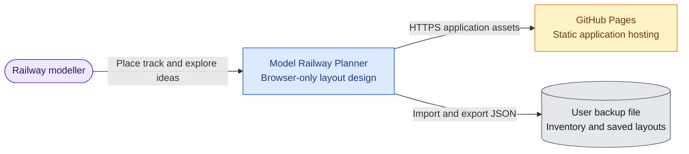

# model-railway-planner

A free, browser-only **model railway track planner** for designing **Hornby OO gauge layouts**.
Drag and snap track pieces, try baseboard shapes, save alternative ideas and calculate a shopping
list for the extra track you need. No account, backend or cloud database is required.

The initial catalog targets Hornby OO (16.5 mm gauge). TypeScript, Vite and D3/SVG power the
zoomable editor; the progressive web app supports offline use and installation where available.


Example layout using synthetic inventory. Orange dashed track identifies the pieces still to buy.

## System Context

The planner runs in a standard browser and keeps inventory and saved ideas on the user's device.
Static hosting distributes application code, not user layouts.



See the [C4 architecture: containers, components and code map](docs/architecture.md#containers)
for the implementation drilldown and placement/persistence sequence.

## Product Brief

This section preserves the original requirements and agreed direction:

- Drag-and-drop track planning, with snapping between compatible connectors.
- Inventory entered and saved locally. Planning can exceed owned stock; each layout has a shopping
  list of the extra pieces needed, shown as orange dashed track.
- Multiple independently saved layout ideas, each drawing on the same inventory.
- Unbounded planning space or a baseboard formed from joined rectangles.
- Pan and zoom, touch placement and keyboard/exact-coordinate alternatives.
- Detect same-level overlaps and insufficient nominal parallel spacing, while warning where
  rolling-stock clearance still needs physical verification.
- Client-side Vite, TypeScript and D3/SVG, with testable domain logic separate from rendering.
- A Node Dev Container, linting, formatting, type checking, unit tests and browser tests.
- Offline/mobile installation through a progressive web app (PWA), where the browser supports it.
- Eventually publish to GitHub Pages through GitHub Actions.
- Expand later to other manufacturers (for example Peco and Marklin) and scales O, N and TT.
- Use GitHub Issues to track bugs and follow-up work; begin with iterative development.

## Online App and Releases

The release pipeline builds and tests the production app at its GitHub Pages subpath, then deploys
the same artifact on a successful `main` push. Application versions are calculated from Git history
using GitVersion. The UI displays the build version, `version.json` provides it as JSON and Pages
adds `deployment.json` with the exact deployed commit. Release tags use plain `X.Y.Z`, without
floating aliases, and are created only after deployment succeeds.

Pull requests run lint, version calculation and frontend format/lint/type/unit/browser checks.
PRs, forks and manual dispatches cannot publish Pages or create release tags.

## Run Locally

Use Node 24 LTS with its bundled npm 11 or newer. Alternatively open the repository in the
[Dev Container](.devcontainer/devcontainer.json); dependency installation is explicit, not automatic.

```text
npm ci
npm run dev
```

Open the Vite URL printed in the terminal (normally port 5173). Choose a piece and click or tap the
plan, or drag it from the catalog with a moving track preview. Enter your quantities in **Track
inventory** whenever you're ready. The compact catalog groups straights, curves, points and
miscellaneous pieces in collapsible sections; search by code or name.

Drag a placed piece to move it. Each idea uses the owned collection independently. Extra pieces
remain placeable and appear as orange dashed track, with quantities under **Shopping list**.
Increasing inventory or removing pieces updates the shortfall immediately. Where several identical
pieces are placed, the earliest ones count as owned; moving one does not change this ordering.

Use **New idea**, **Duplicate** and the layout selector to explore alternatives. Changes autosave
after a successful browser-storage write. **Export backup** downloads all inventory and layouts;
**Import backup** validates a file and asks before replacing existing data.

## Editing and Limits

- Model coordinates, lengths and radii are millimetres; angles are degrees, clockwise on screen.
- Snap aligns both endpoint position and tangent. Occupied endpoints cannot accept extra pieces.
- **Rotate new** and **Reverse new curve** orient new track. Points have distinct handed catalog
  entries; their handedness is not changed by the curve-reversal control.
- Select a placed piece for exact X/Y/angle editing. Arrow keys move 5 mm; Shift + arrows move 1 mm.
  `R` rotates 22.5 degrees; Delete removes; Escape cancels placement.
- Empty background drag pans; wheel/pinch or the zoom controls zoom. **Fit plan** frames the layout.
- Baseboard rectangles must overlap or share an edge, not merely touch at a corner.
- Inventory reductions are allowed and recalculate the shopping list for each saved idea.
- Hover over placed track for its code, name and dimensions; the selected-piece inspector provides
  the same information without hover. Unselected track uses a pointer; selected track uses a grab
  cursor.
- Track joins have 1.5-pixel visual separator strokes at every connector, independent of zoom.
  They do not change physical track length, positions or snapping.
- **Dark mode** switches the interface theme and saves the preference on this device. The initial
  theme follows the browser's system preference.

Clearance is a conservative planning aid, not a guarantee that trains can pass. The nominal
Hornby set-track spacing is 67 mm centre-to-centre, derived from the 371/438/505 mm standard radii.
Parallel checks allow 0.5 mm for rounded catalog geometry. A 30 mm planning footprint is used for
same-level overlap and board containment, with sampled curves (at most 5 mm between samples).
Valid connector neighbourhoods and the local fan between standard point exits are exempt from
parallel checks, not entire connected components. Points and curved stock overhang still require
physical validation. Diamond crossings contain two independent routes and four connectors; their
internal crossing is permitted, but unrelated track still cannot overlap them. Bridges, elevations,
flexible track and custom catalog editing are not implemented.

## Hornby OO Catalog

The catalog includes 22 entries, including all seven standard-range point types and both diamond
crossing hands. It is not the complete Hornby range. Numeric dimensions and product codes are
referenced from product descriptions; no product photographs or artwork are copied.

| Pieces        | Geometry                                                   | Sources                                                                                                                                                                  |
| ------------- | ---------------------------------------------------------- | ------------------------------------------------------------------------------------------------------------------------------------------------------------------------ |
| R600 / R601   | 168 / 335 mm straight                                      | [R600](https://uk.hornby.com/products/straight-track-r600), [R601](https://uk.hornby.com/products/double-straight-r601)                                                  |
| R603          | 670 mm straight                                            | [Long straight](https://uk.hornby.com/products/long-straight-r603)                                                                                                       |
| R604 / R605   | 371 mm radius; 22.5 / 45 degrees                           | [R604](https://uk.hornby.com/products/curve-1st-radius-r604), [R605](https://uk.hornby.com/products/double-curve-1st-radius-r605)                                        |
| R606          | 438 mm radius; 22.5 degrees                                | [R606](https://uk.hornby.com/products/curve-2nd-radius-r606)                                                                                                             |
| R607 / R643   | Nominal 438 mm radius; 45 / 11.25 degrees                  | [R607](https://uk.hornby.com/products/double-curve-2nd-radius-r607), [R643](https://uk.hornby.com/products/half-curve-2nd-radius-r643)                                   |
| R608 / R609   | 505 mm radius; 22.5 / 45 degrees                           | [R608](https://uk.hornby.com/products/curve-3rd-radius-r608), [R609](https://uk.hornby.com/products/double-curve-3rd-radius-r609)                                        |
| R8072 / R8073 | 168 mm straight plus 438 mm radius / 22.5 degree branch    | [Left point](https://uk.hornby.com/products/left-hand-point-r8072), [Right point](https://uk.hornby.com/products/right-hand-point-r8073)                                 |
| R8261 / R8262 | Nominal 572 mm radius; 22.5 / 45 degrees                   | [R8261](https://uk.hornby.com/products/curve-4th-radius-r8261), [R8262](https://uk.hornby.com/products/double-curve-4th-radius-r8262)                                    |
| R628          | 852 mm radius; 11.25 degrees                               | [Large-radius half curve](https://uk.hornby.com/products/half-curve-33-large-radius-r628)                                                                                |
| R8074 / R8075 | Approximate curved-point branches, not CAD geometry        | [Left curved point](https://uk.hornby.com/products/left-hand-curved-point-r8074), [Right curved point](https://uk.hornby.com/products/right-hand-curved-point-r8075)     |
| R8076         | Idealised symmetric 852 mm / 11.25 degree Y branches       | [Y point](https://uk.hornby.com/products/y-point-r8076), [Dimensional comparison](https://www.railwayscenics.com/track_comparison_oo.php)                                |
| R8077 / R8078 | 245 mm straight and idealised 852 mm / 11.25 degree branch | [Left express point](https://uk.hornby.com/products/left-hand-express-point-r8077), [Right express point](https://uk.hornby.com/products/right-hand-express-point-r8078) |
| R614 / R615   | Idealised 168 / 181 mm diamond crossing; 22.5 degrees      | [Left crossing](https://uk.hornby.com/products/diamond-crossing-left-hand-r614), [Right crossing](https://uk.hornby.com/products/diamond-crossing-right-hand-r615)       |

Sources reviewed 22 November 2026. Some descriptions conflate curve length and radius. R607 and
R8261 use nominal set-track radii and carry a warning. All points and diamond crossings are
idealised, not manufacturer CAD models: check their real connector positions before buying or
building. Curved points use an approximate 438 mm / 33.75 degree route and a 67 mm lead followed by
a 438 mm / 22.5 degree route. Express points use an idealised straight lead before their branch.
Geometry warnings appear in the palette tooltip, selected-piece description, hover tooltip and
planning checks. Short straights, flexible track and further specialist pieces remain follow-ups.

## Storage and Offline Use

Data is stored in this browser, on this device and origin. Clearing site data, private-browsing
restrictions, browser eviction or changing the site's URL/origin can remove or hide it. There is no
cross-device sync. Export backups regularly.

Malformed or future-version saved data locks editing rather than overwriting it. Export preserves
the original readable bytes for recovery. Failed writes reject the edit and display an error.
Changes in another tab lock editing until reload. Imports validate schema, catalog references,
finite coordinates, inventory quantities and unique IDs; placement problems are displayed for review.

To try the installable/offline production build:

```text
npm run build
npm run preview
```

Service workers run on localhost or HTTPS, not arbitrary HTTP network addresses. After the initial
online load, the production shell is cached for offline use. Installation varies by browser:
Chromium offers an install option; iOS uses Safari's **Add to Home Screen**. Native packaging and
app-store distribution are not implemented. Updates are offered explicitly; app caches and user
documents are kept separate.

For a project-subpath deployment, build with `VITE_BASE_PATH` set to the site's path with a
trailing slash. Asset URLs, manifest and service-worker scope follow that base. Pages deployment
uses `/model-railway-planner/`; browser tests use that same base rather than only testing `/`.
Set `VITE_APP_VERSION` for an identifiable production build; local builds display `development`
when it is absent.

## Development

```text
npm run typecheck
npm run lint
npm run format:check
npm test
npm run build
npx playwright install chromium
npm run test:browser
```

Domain tests cover geometry, snapping, circuit closure, clearance, boards, inventory and storage.
Browser tests use the production build and cover editing, shopping lists, persistence, palette
drag previews/cancellation, grouped search, dark mode, tooltips, visual joins, rejected operations,
mobile alternatives and offline reload. Tests need no cloud credentials. Linux browser tests may require
`npx playwright install --with-deps chromium`.

The Vite starter's newer TypeScript version was adjusted to TypeScript 6 to match the lint parser's
supported peer range. npm's lockfile defines the reproducible dependency set.
Workbox's build-time `glob` is overridden to a patched release; remove that override once Workbox
ships a patched compatible dependency range, then rerun production/offline tests.
Regenerate install icons from the original SVG with `npm run icons`.
Git hooks are not installed automatically; the opt-in pre-commit configuration complements npm's
frontend checks.

## Next Milestones

- Validate more real-world layouts, point/countercurve combinations and rolling-stock envelopes.
- Expand the verified Hornby catalog, then add manufacturer/scale profiles and compatibility rules.
- Add undo/redo, selection groups and print/export tools if user feedback calls for them.
- Verify the Dev Container build and mobile installation on physical devices.
- Keep hosted CI, Pages publication and offline behavior verified as the catalog evolves.

## License

[MIT](LICENSE). Manufacturer names and product codes identify compatible track; this project is
independent and is not endorsed by the manufacturers.
