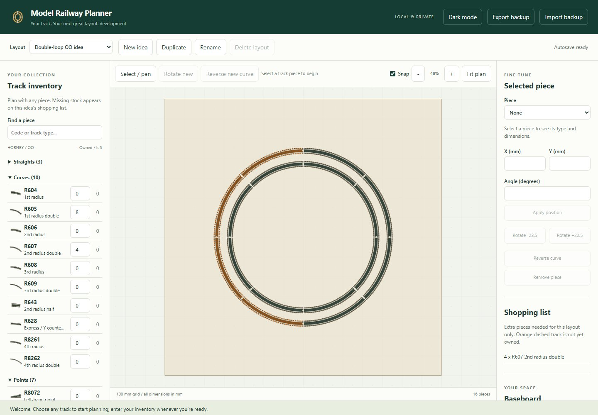
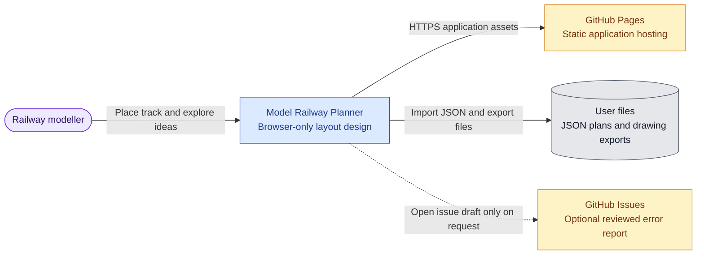

# model-railway-planner

A free, browser-only **model railway track planner** for designing **Hornby OO gauge layouts**.
Drag and snap track pieces, try baseboard shapes, save alternative ideas and calculate a shopping
list for the extra track you need. No account, backend or cloud database is required.

The catalog targets Hornby, Peco Setrack and Bachmann OO (16.5 mm gauge). TypeScript, Vite and D3/SVG power the
zoomable editor; the progressive web app supports offline use and installation where available.

[Open the planner](https://f2calv.github.io/model-railway-planner/) or [run it locally](#run-locally).



Example layout using synthetic inventory. Orange dashed track identifies the pieces still to buy.

## System Context

The planner runs in a standard browser and keeps inventory and saved ideas on the user's device.
Static hosting distributes application code, not user layouts.



See the [C4 architecture: containers, components and code map](docs/architecture.md#containers)
for the implementation drilldown and placement/persistence sequence.

## Features

- Drag-and-drop track placement with connector snapping and track descriptions.
- Marquee/Ctrl multi-selection, rigid group movement, lock/unlock and undo/redo.
- Shared inventory, multiple layout ideas and shopping lists for pieces still to buy.
- Unbounded canvas or draggable polygon, circular and arc-strip baseboards, with module presets.
- Named rooms and furniture beneath baseboards and track; choose a room independently for each idea.
- Pan and zoom, touch placement, keyboard controls and exact-coordinate editing.
- Planning warnings for overlaps, baseboard boundaries and nominal parallel spacing.
- Optional DC/DCC power checks, explicit feeds, self-isolating point positions and bypass clips.
- Local autosave and JSON backup import/export, without accounts or cloud storage.
- Dark mode and installable offline use where the browser supports it.
- English, German, French, Spanish and Italian interfaces.
- Optional track sounds, configurable delete confirmation and collapsible activity/history.
- SVG/PNG drawings, inventory/shopping CSV and print/PDF overviews.

## Run Locally

Use Node 24 LTS with its bundled npm 11 or newer. Alternatively open the repository in the
[Dev Container](.devcontainer/devcontainer.json); dependency installation is explicit, not automatic.

```text
npm ci
npm run dev
```

Open the Vite URL printed in the terminal (normally port 5173). Choose a piece and click or tap the
plan, or drag it from the catalog with a moving track preview. Enter your quantities in **Track
inventory** whenever you're ready. The compact catalog groups straights, curves, points and
miscellaneous pieces in collapsible sections; search by code or name.

Drag a placed piece to move it, or select several and move them together. Each idea uses the owned collection independently. Extra pieces
remain placeable and appear as orange dashed track, with quantities under **Shopping list**.
Increasing inventory or removing pieces updates the shortfall immediately. Where several identical
pieces are placed, the earliest ones count as owned; moving one does not change this ordering.

Use **New idea**, **Duplicate** and the layout selector to explore alternatives. Changes autosave
after a successful browser-storage write. **Export backup** downloads all inventory and layouts;
**Import backup** validates a file and asks before replacing existing data.

## Editing and Limits

- Model coordinates, lengths and radii are millimetres; angles are degrees, clockwise on screen.
- Snap aligns both endpoint position and tangent. Occupied endpoints cannot accept extra pieces.
- **Rotate new** and **Reverse new curve** orient new track. Points have distinct handed catalog
  entries; their handedness is not changed by the curve-reversal control.
- Drag blank space to select fully enclosed pieces; Ctrl/Command-click toggles selection.
  Ctrl/Command+A selects all. Groups move rigidly and snap at exposed, direction-compatible ends.
- The inspector edits the selected piece or group around its anchor. Arrow keys move 5 mm;
  Shift + arrows move 1 mm. `R` rotates 22.5 degrees; Delete removes; Escape cancels a gesture.
- **Space + drag** pans on desktop; touch background drag pans. Wheel/pinch and zoom controls zoom.
  A second finger cancels an in-progress track drag before pinch zooming. **Fit plan** frames the layout.
- Right-click a piece/group for lock actions, or use **Lock selection** / **Unlock selection**.
  Locked pieces show a padlock and different bed colour. Any locked member prevents group move/delete.
- Delete asks for confirmation by default. Its skip checkbox and the **Confirm piece deletion** setting
  persist on this device. Deleting an entire idea remains separately confirmed.
- Ctrl/Command+Z undoes; Ctrl/Command+Shift+Z or Ctrl/Command+Y redoes. Up to 100 whole-document steps
  are retained during this session, including inventory and layout changes. Selection and previews
  are not history. Reload clears undo/redo and the activity pane's latest 300 entries.
- Disconnected baseboard shapes are allowed and generate warnings; point/edge contact or overlap joins them.
- Inventory reductions are allowed and recalculate the shopping list for each saved idea.
- Hover over placed track for its code, name and dimensions; the selected-piece inspector provides
  the same information without hover. Unselected track uses a pointer; selected track uses a grab
  cursor.
- Track joins have 1.5-pixel visual separator strokes at every connector, independent of zoom.
  They do not change physical track length, positions or snapping.
- **Dark mode** switches the interface theme and saves the preference on this device. The initial
  theme follows the browser's system preference.
- **Language**, optional **Track sounds** (off initially) and delete preferences persist separately
  from the document. User layout names and product codes are never translated.
- **Reset entire inventory** zeroes all quantities after confirmation, keeps layouts and is undoable.
- **Print / PDF** creates a page-fit overview, not a calibrated 1:1 construction template.
  SVG retains millimetre dimensions; PNG is capped at 4096 pixels per dimension. Inventory CSV covers
  the shared collection; shopping CSV covers the active idea. CSV headings remain English for interchange.

Clearance is a conservative planning aid, not a guarantee that trains can pass. The nominal
Hornby set-track spacing is 67 mm centre-to-centre, supported by its official track geometry diagram.
This is the project's OO planning envelope, not a universal Peco/Bachmann or other-scale standard.
Parallel checks allow 0.5 mm for rounded catalog geometry. A 30 mm planning footprint is used for
same-level overlap and board containment, with sampled curves (at most 5 mm between samples).
Valid connector neighbourhoods and the local fan between standard point exits are exempt from
parallel checks, not entire connected components. Points and curved stock overhang still require
physical validation. Diamond crossings contain two independent routes and four connectors; their
internal crossing is permitted, but unrelated track still cannot overlap them. Bridges, elevations,
flexible track, platform furniture and custom catalog editing are not implemented.

## Baseboard Shapes

Choose **Edit baseboards** to move and reshape boards without moving track. Drag a shape or module
preset from the palette, or choose it and tap the canvas. Rectangles/squares, right triangles,
circles, semicircles and adjustable arc strips are supported. Corner handles turn rectangles into
convex quadrilaterals, including trapezoids; coordinate inputs provide a non-drag alternative.

Boards snap to nearby edges, vertices and circular boundaries without automatic rotation.
The inspector edits dimensions, rotation, radius, inner radius and arc sweep. Undo/redo and JSON,
SVG, PNG and print/PDF exports retain their shapes. Disconnected boards and track exposed by board
edits are allowed but produce planning warnings. See the [baseboard guide](docs/baseboards.md) for
the six supplier-size presets, editing rules and physical limitations.

## Rooms and Furniture

Use **New room** to save a named room, then choose it under **Room** for each layout.
The drawing layers are room/furniture, baseboards, then track. Set **Room shape role** to
**Room outline**, enter dimensions and use **Add room rectangle**. For a table, choose
**Furniture**, enter its name and dimensions, and add another rectangle.

The full geometric palette and corner editing also work for rooms and furniture. Enable
**Edit room shapes** to edit only that bottom layer. Room edits affect every layout assigned
to the same named room, but never move its boards or track. Outside-room placement produces
advisory warnings; furniture is a reference, not a support or collision constraint.
See the [room planning guide](docs/rooms.md) for sharing, saving and limitations.

## Track Catalogs

The catalog contains 47 entries: 31 Hornby (including R645 and three power accessories), seven Peco Setrack
and nine Bachmann OO pieces.
See the [track catalog guide](docs/catalog.md) for supported dimensions, manufacturer sources,
geometric compatibility rules and deliberately deferred furniture. Mixed-brand snapping is a planning
aid, not certification of rail heights, joiners or rolling-stock clearance.

For R645, select one unlocked Hornby straight at least 168 mm long, then choose R645 in the palette.
It attaches centrally without adding track or connectors, and has its own inventory/shopping count.
Use **Remove R645 accessory** to detach it without removing the host. It moves, locks and deletes
with its host; undo and backups retain it. The marker is schematic: road, gate and barrier clearance
is not checked. R636 includes two parallel tracks but is counted as one purchased item.

## Track Power

Choose **DC (analogue)** or **DCC (digital)** under **Track power** for each idea.
Select an unlocked track piece, choose its feed/connector and explicitly mark whether it is
connected to the selected controller. R8206 is DC; R8241 is DCC. Manual feeders and R602/R8242
clips are also supported as planning declarations.

Hornby points power only the selected route unless a bypass is declared. Choose the point position,
an **R8232 pair (2 clips)** or a soldered bypass. Inventory counts individual R8232 clips:
enter 20 for the current full pack. Clip shortages appear on the shopping list.

The optional overlay distinguishes powered, unpowered, partial and unverified routes without
replacing stock/lock colours. DC dead sidings may be intentional; DCC warns about unpowered
sections and uncertain continuity. This assumes one controller and sound rail joints, not a
polarity, short-circuit or wiring certificate. See the [power planning guide](docs/power.md).

## Storage and Offline Use

Data is stored in this browser, on this device and origin. Clearing site data, private-browsing
restrictions, browser eviction or changing the site's URL/origin can remove or hide it. There is no
cross-device sync. Export backups regularly.

Malformed or future-version saved data locks editing rather than overwriting it. Export preserves
the original readable bytes for recovery. Failed writes reject the edit and display an error.
Changes in another tab lock editing until reload. Imports validate schema, catalog references,
finite coordinates, inventory quantities and unique IDs; placement problems are displayed for review.

The current backup format is version 6 and imports versions 1–5. Legacy rectangles
become polygons with stable IDs. The existing storage key
is retained to find older plans. Named rooms, furniture, room assignments, locks, attached accessories
and power settings are included in backups; display/audio/delete preferences
and session history are not. Close or update older app tabs before editing a migrated document.

Unexpected errors open a visible dialog with a link to draft a GitHub issue. Only the public app
version and a generic error category are prefilled: no layout, inventory, stack trace or activity
is transmitted automatically. Review anything you add before submitting an issue.

To try the installable/offline production build:

```text
npm run build
npm run preview
```

Service workers run on localhost or HTTPS, not arbitrary HTTP network addresses. After the initial
online load, the production shell is cached for offline use. Installation varies by browser:
Chromium offers an install option; iOS uses Safari's **Add to Home Screen**. Native packaging and
app-store distribution are not implemented. Updates are offered explicitly; app caches and user
documents are kept separate. Failed saves block ordinary updates; recovery mode permits an explicit
app update without rewriting damaged or newer-version data.

The Dev Container image has been built and its non-root Node/npm tools verified. Physical Android
installation and offline use still need device verification; browser emulation is not a substitute.

For a project-subpath deployment, build with `VITE_BASE_PATH` set to the site's path with a
trailing slash for both build and preview. Asset URLs, manifest and service-worker scope follow that base. Pages deployment
uses `/model-railway-planner/`; browser tests use that same base rather than only testing `/`.
Set `VITE_APP_VERSION` for an identifiable production build; local builds display `development`
when it is absent.

## Development

```text
npm run typecheck
npm run lint
npm run format:check
npm test
npm run build
npx playwright install chromium
npm run test:browser
```

Domain tests cover geometry, compatibility, atomic group commands, locks, bounded history,
localization, exports, boards, inventory and storage.
Browser tests use the production build and cover editing, shopping lists, persistence, palette
drag previews/cancellation, grouped search, dark mode, tooltips, visual joins, rejected operations,
mobile alternatives, two-finger pinch cancellation, PNG size limits, print/PDF and offline reload.
`test:browser` serves existing `dist` output: rebuild after source changes and keep the same
`VITE_BASE_PATH` for the test command. Tests need no cloud credentials. Linux browser tests may require
`npx playwright install --with-deps chromium`.

The Vite starter's newer TypeScript version was adjusted to TypeScript 6 to match the lint parser's
supported peer range. npm's lockfile defines the reproducible dependency set.
Workbox's build-time `glob` is overridden to a patched release; remove that override once Workbox
ships a patched compatible dependency range, then rerun production/offline tests.
Regenerate install icons from the original SVG with `npm run icons`.
Git hooks are not installed automatically; the opt-in pre-commit configuration complements npm's
frontend checks.

Track bugs and future work in [GitHub Issues](https://github.com/f2calv/model-railway-planner/issues).

## License

[MIT](LICENSE). Manufacturer names and product codes identify compatible track; this project is
independent and is not endorsed by the manufacturers.
