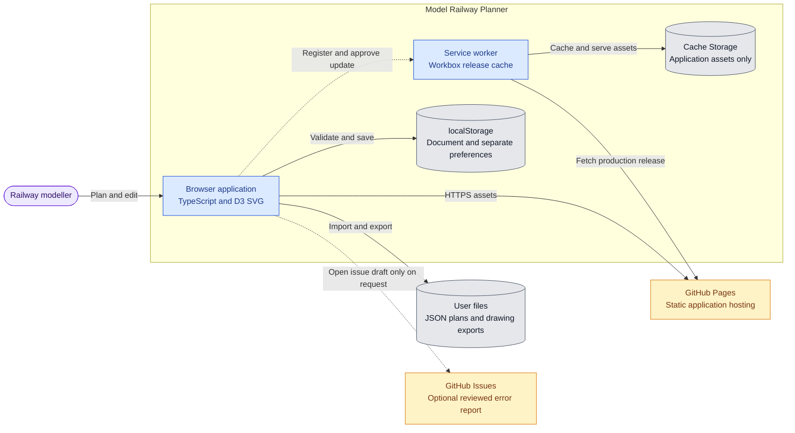
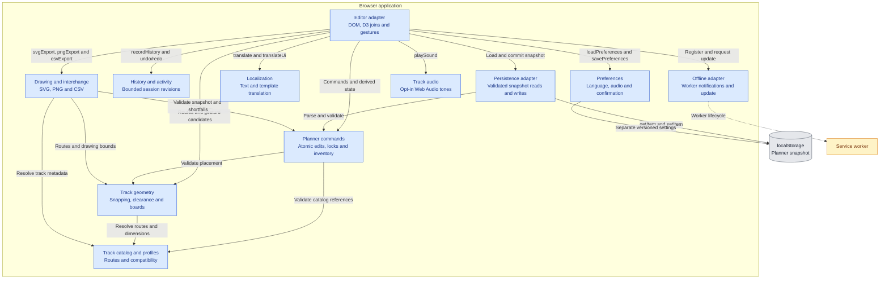
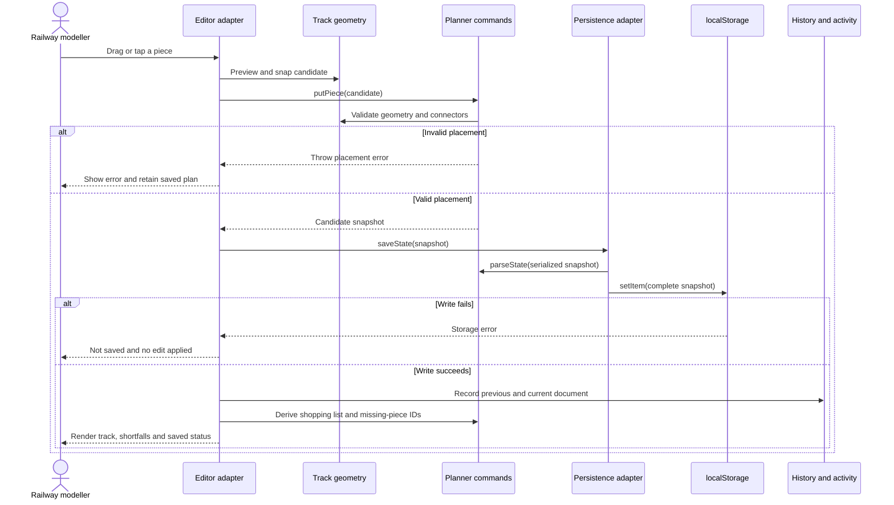

# Model Railway Planner Architecture

These C4 views describe the current browser-only implementation. The
[System Context](../README.md#system-context) is maintained in the README; this drilldown covers
containers, components and persistence. No backend, authentication service or cloud user database
exists.

## Containers

The application executes on the user's device. GitHub Pages serves static assets; browser storage
holds user documents and the service worker caches application assets separately.

Solid arrows represent direct interactions; the dotted arrow represents asynchronous worker
registration/update events. Inventory and layout data are not sent to Pages.

## Components

The browser adapter owns DOM rendering and gestures. Pure state and geometry modules validate
commands without D3 or storage access; persistence publishes only validated complete snapshots.

All components execute within one bundled browser application; they are responsibilities, not
independently deployed services. Offline registration and update handling currently live in the
editor entrypoint rather than a separate module.
History holds complete document revisions in memory and publishes a step only after a successful
save. Preferences are independent of document undo/redo and JSON backups. Activity is session-only;
unexpected-error reports never automatically include it or document content.

## Code Map

| Component                  | Responsibility                                                                | Code location                                                            | Provides                                                                                        | Requires                                           |
| -------------------------- | ----------------------------------------------------------------------------- | ------------------------------------------------------------------------ | ----------------------------------------------------------------------------------------------- | -------------------------------------------------- |
| Editor adapter             | Controls, SVG joins, previews, pointer/keyboard gestures and visible errors   | [main.ts](../src/main.ts), [style.css](../src/style.css)                 | Browser UI and command dispatch                                                                 | State, geometry, catalog, storage, PWA integration |
| Planner commands           | Atomic group/layout edits, locks, inventory, shortfalls and backup validation | [state.ts](../src/state.ts), [model.ts](../src/model.ts)                 | `putPieces`, `transformPieces`, `removePieces`, `setPieceLocks`, `resetInventory`, `parseState` | Catalog and geometry                               |
| Track geometry             | Model-space routes, poses, group snapping, clearance and board union          | [geometry.ts](../src/geometry.ts)                                        | `ports`, `snapPiece`, `snapGroup`, `placementProblem`, `pathData`                               | Catalog routes and profiles                        |
| Track catalog and profiles | Verified nominal dimensions, warnings and geometric compatibility             | [catalog.ts](../src/catalog.ts), [profiles.ts](../src/profiles.ts)       | `catalog`, `definition`, `trackSize`, `planningCompatible`                                      | Domain types                                       |
| Persistence adapter        | Validate a whole snapshot before writing; surface malformed/denied storage    | [storage.ts](../src/storage.ts)                                          | `loadState`, `saveState`, `StoragePort`                                                         | State parser and browser Storage                   |
| History and activity       | Bound undo/redo revisions and activity entries to the current session         | [history.ts](../src/history.ts)                                          | `recordHistory`, `undoHistory`, `redoHistory`, `recordActivity`                                 | Document model                                     |
| Preferences                | Validate and persist independent UI settings                                  | [preferences.ts](../src/preferences.ts)                                  | `loadPreferences`, `savePreferences`                                                            | Browser Storage port                               |
| Localization               | Translate owned UI text/templates without changing user names or codes        | [i18n.ts](../src/i18n.ts), [translations.json](../src/translations.json) | `translate`, `translateUi`                                                                      | Language value and translation data                |
| Drawing and interchange    | Generate safe standalone drawings and formula-protected CSV                   | [exports.ts](../src/exports.ts)                                          | `drawingLayers`, `layoutBounds`, `svgExport`, `pngExport`, `csvExport`                          | State, geometry and catalog                        |
| Track audio                | Synthesize optional local feedback with cleaned-up audio nodes                | [sound.ts](../src/sound.ts)                                              | `playSound`                                                                                     | Browser Web Audio                                  |
| Offline adapter            | Build worker/manifest, register it and offer explicit updates                 | [vite.config.ts](../vite.config.ts), [main.ts](../src/main.ts)           | PWA assets and update action                                                                    | Vite PWA plugin and browser service worker         |

## Runtime Scenarios

### Placing Track

Missing stock is allowed and contributes to the active idea's shopping list. Invalid geometry or
failed persistence leaves the committed snapshot unchanged.

The same save-before-publication boundary applies to group moves, deletion, inventory reset and
undo/redo. Pointer cancellation discards previews. SVG hit elements retain identity across selection
redraws so native touch events can reach D3; a second pointer explicitly cancels track dragging before
the zoom owner takes over.

## Document and Update Safety

Format 2 retains piece locks and migrates supported format 1 documents. Unsupported/newer formats
and unreadable storage lock editing while preserving original bytes. Storage events prevent silent
cross-tab overwrite. App-cache updates are explicit and separate from user documents: normal
updates require a successful save, while recovery mode can update the app without rewriting the
document. Background cache notifications do not replace foreground save/recovery errors.

## Deployment Flow

The [CI caller](../.github/workflows/ci.yml) calculates a build version, validates the production
app at `/model-railway-planner/` and transfers the tested artifact to the shared Pages publisher.
PRs validate without deploying. A default-branch push deploys and verifies live commit/version
identity before creating the immutable application release tag.

## Architecture Signals

- **Hub component:** [main.ts](../src/main.ts) owns UI, gestures, dialogs and PWA registration.
  It is the principal change hotspot; no framework or extra abstraction is required merely to
  split it, but focused adapters may help when these responsibilities evolve independently.
- **No backend boundary:** all documents remain origin-local. Export is the recovery boundary,
  not cloud backup or synchronization.
