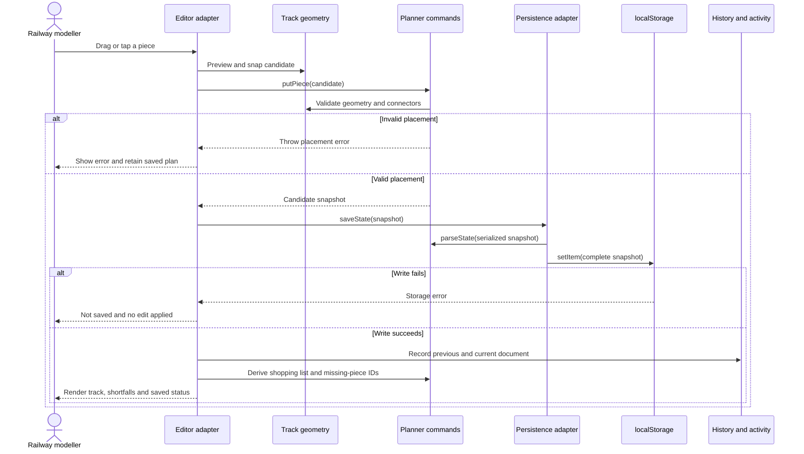

# Model Railway Planner Architecture

These C4 views describe the current browser-only implementation. The
[System Context](../README.md#system-context) is maintained in the README; this drilldown covers
containers, components and persistence. No backend, authentication service or cloud user database
exists.

The [client-side planner decision record](adr-0001-client-side-planner.md) explains the purpose,
boundaries and tradeoffs behind these views.

## Containers

The application executes on the user's device. GitHub Pages serves static assets; browser storage
holds user documents and the service worker caches application assets separately.

Solid arrows represent direct interactions; the dotted arrow represents asynchronous worker
registration/update events. Inventory and layout data are not sent to Pages.

## Components

The browser adapter owns DOM rendering and gestures. Pure state and geometry modules validate
commands without D3 or storage access; persistence publishes only validated complete snapshots.

```mermaid
flowchart TB
    subgraph browser [Browser application]
        editor["Editor adapter<br/>DOM, D3 joins and gestures"]:::component
        catalog_browser["Catalog browser<br/>Read-only filters and product table"]:::component
        state["Planner commands<br/>Atomic edits, locks and inventory"]:::component
        geometry["Track geometry<br/>Snapping and clearance"]:::component
        board_editor["Geometric editor<br/>Board and room shape gestures"]:::component
        boards["Baseboard geometry<br/>Shapes, joins and containment"]:::component
        rooms["Room checks<br/>Sampled boundary warnings"]:::component
        power_editor["Power editor<br/>Feed and point declarations"]:::component
        power["Power checks<br/>Conservative route reachability"]:::component
        catalog["Track catalog and profiles<br/>Routes and compatibility"]:::component
        storage["Persistence adapter<br/>Validated snapshot reads and writes"]:::component
        history["History and activity<br/>Bounded session revisions"]:::component
        preferences["Preferences<br/>Language, audio and safe page state"]:::component
        language["Localization<br/>Text and template translation"]:::component
        exports["Drawing and interchange<br/>SVG, PNG and CSV"]:::component
        sound["Track audio<br/>Opt-in Web Audio tones"]:::component
        pwa["Offline adapter<br/>Worker notifications and update"]:::component
    end
    documents[("localStorage<br/>Planner snapshot")]:::store
    worker["Service worker"]:::external
    editor -->|"Commands and derived state"| state
    editor -->|"Render current stock and language"| catalog_browser
    catalog_browser -->|"filterCatalog and catalogManufacturers"| catalog
    catalog_browser -->|"activeLayout and used"| state
    catalog_browser -->|"translate and translateUi"| language
    catalog -->|"Translated names and category labels for multilingual search"| language
    editor -->|"Routes and gesture candidates"| geometry
    editor -->|"Delegate board or room mode"| board_editor
    board_editor -->|"Layer commands through save boundary"| state
    board_editor -->|"snapBoard and moveBoardCorner"| boards
    editor -->|"roomProblems"| rooms
    editor -->|"Render power controls and results"| power_editor
    editor -->|"analyzePower"| power
    power_editor -->|"setElectrical and updateLayout through save boundary"| state
    power_editor -->|"Connector positions"| geometry
    power_editor -->|"Supported power options"| catalog
    power -->|"ports, connected and routePose"| geometry
    power -->|"Electrical behavior and compatible profiles"| catalog
    state -->|"validateElectrical and powerSupplies"| power
    rooms -->|"assignedRoom and activeLayout"| state
    rooms -->|"Sampled track footprint"| geometry
    rooms -->|"containsBoard and boardBounds"| boards
    editor -->|"Load and commit snapshot"| storage
    editor -->|"Register and request update"| pwa
    editor -->|"recordHistory and undo/redo"| history
    editor -->|"Load/save preferences and safe page settings"| preferences
    editor -->|"translate and translateUi"| language
    editor -->|"svgExport, pngExport and csvExport"| exports
    editor -->|"playSound"| sound
    state -->|"Validate placement"| geometry
    state -->|"Validate shapes and connectivity warnings"| boards
    state -->|"Validate catalog references"| catalog
    geometry -->|"Resolve routes and dimensions"| catalog
    geometry -->|"containsBoard"| boards
    storage -->|"Parse and validate"| state
    storage -->|"getItem and setItem"| documents
    preferences -->|"Separate versioned settings"| documents
    preferences -->|"Known gauges and category metadata"| catalog
    exports -->|"Validate snapshot and shortfalls"| state
    exports -->|"Routes and drawing bounds"| geometry
    exports -->|"boardPath and boardBounds"| boards
    exports -->|"Resolve track metadata"| catalog
    pwa -.->|"Worker lifecycle"| worker
    classDef component fill:#dbeafe,stroke:#1d4ed8,color:#1e3a8a
    classDef store fill:#e5e7eb,stroke:#4b5563,color:#111827
    classDef external fill:#fef3c7,stroke:#d97706,color:#78350f
```

All components execute within one bundled browser application; they are responsibilities, not
independently deployed services. Offline registration and update handling currently live in the
editor entrypoint rather than a separate module.
History holds complete document revisions in memory and publishes a step only after a successful
save. Preferences are independent of document undo/redo and JSON backups. Activity is session-only;
unexpected-error reports never automatically include it or document content.

## Code Map

| Component                  | Responsibility                                                                          | Code location                                                                        | Provides                                                                                        | Requires                                            |
| -------------------------- | --------------------------------------------------------------------------------------- | ------------------------------------------------------------------------------------ | ----------------------------------------------------------------------------------------------- | --------------------------------------------------- |
| Editor adapter             | Controls, SVG joins, previews, pointer/keyboard gestures and visible errors             | [main.ts](../src/main.ts), [style.css](../src/style.css)                             | Browser UI and command dispatch                                                                 | State, geometry, catalog, storage, PWA integration  |
| Catalog browser            | Read-only registered-piece page with independent gauge, manufacturer and search filters | [catalog-browser.ts](../src/catalog-browser.ts)                                      | `CatalogBrowser`, owned/used quantities and product links                                       | Catalog/profiles, state queries and localization    |
| Planner commands           | Atomic group/layout edits, locks, inventory, shortfalls and backup validation           | [state.ts](../src/state.ts), [model.ts](../src/model.ts)                             | `putPieces`, `transformPieces`, `removePieces`, `setPieceLocks`, `resetInventory`, `parseState` | Catalog, geometry and power checks                  |
| Track geometry             | Model-space routes, poses, group snapping and clearance                                 | [geometry.ts](../src/geometry.ts)                                                    | `ports`, `snapPiece`, `snapGroup`, `placementProblem`, `pathData`                               | Catalog routes/profiles and board containment       |
| Geometric editor           | Shared palette, inspector and reversible gestures for independent board/room layers     | [shape-editor.ts](../src/shape-editor.ts)                                            | `ShapeEditor`, `ShapeLayer`, previews and command dispatch                                      | Planner commands, geometry and editor save boundary |
| Room checks                | Advisory sampled boundary checks for assigned rooms and furniture                       | [rooms.ts](../src/rooms.ts)                                                          | `roomProblems`                                                                                  | Planner commands, track and board geometry          |
| Power editor               | Feed/point controls and textual power results                                           | [power-editor.ts](../src/power-editor.ts)                                            | `PowerEditor` and command dispatch                                                              | State, geometry, catalog and editor save boundary   |
| Power checks               | Definite/possible reachability, independent routes, isolation and clip requirements     | [power.ts](../src/power.ts)                                                          | `analyzePower`, `validateElectrical`, `powerSupplies`                                           | Catalog/profiles, track geometry and domain types   |
| Baseboard geometry         | Analytic shapes, convex corner edits, snapping and union containment                    | [baseboards.ts](../src/baseboards.ts)                                                | `containsBoard`, `joinedBoards`, `snapBoard`, `moveBoardCorner`, `boardPath`, `boardBounds`     | Domain types                                        |
| Track catalog and profiles | Verified nominal dimensions, warnings and geometric compatibility                       | [catalog.ts](../src/catalog.ts), [profiles.ts](../src/profiles.ts)                   | `catalog`, `definition`, `trackSize`, `planningCompatible`                                      | Domain types and pure translation lookup            |
| Persistence adapter        | Validate a whole snapshot before writing; surface malformed/denied storage              | [storage.ts](../src/storage.ts)                                                      | `loadState`, `saveState`, `StoragePort`                                                         | State parser and browser Storage                    |
| History and activity       | Bound undo/redo revisions and activity entries to the current session                   | [history.ts](../src/history.ts)                                                      | `recordHistory`, `undoHistory`, `redoHistory`, `recordActivity`                                 | Document model                                      |
| Preferences                | Validate and persist independent UI settings and safe page state                        | [preferences.ts](../src/preferences.ts), [page-settings.ts](../src/page-settings.ts) | `loadPreferences`, `savePreferences`, `loadPageSettings`, `savePageSettings`                    | Browser Storage port and catalog metadata           |
| Localization               | Translate owned UI text/templates without changing user names or codes                  | [i18n.ts](../src/i18n.ts), [translations.json](../src/translations.json)             | `translate`, `translateUi`                                                                      | Language value and translation data                 |
| Drawing and interchange    | Generate safe standalone drawings and formula-protected CSV                             | [exports.ts](../src/exports.ts)                                                      | `drawingLayers`, `layoutBounds`, `svgExport`, `pngExport`, `csvExport`                          | State, geometry and catalog                         |
| Track audio                | Synthesize optional local feedback with cleaned-up audio nodes                          | [sound.ts](../src/sound.ts)                                                          | `playSound`                                                                                     | Browser Web Audio                                   |
| Offline adapter            | Build worker/manifest, register it and offer explicit updates                           | [vite.config.ts](../vite.config.ts), [main.ts](../src/main.ts)                       | PWA assets and update action                                                                    | Vite PWA plugin and browser service worker          |

Planner and catalog pages use `#planner` and `#catalog` navigation, including direct reloads on
static project-path hosting. Safe page settings use their own validated, versioned localStorage
snapshot: independent catalog filters, disclosures, Snap/overlay, editing mode, per-layout viewports
and scroll positions. An explicit navigation hash takes priority over the remembered page.
These settings are not document revisions, undo steps or backup contents. Selection, dialogs,
gestures and unapplied editor fields remain transient. Stale layout views are pruned and unavailable
brands fall back to their gauge's All option; an unassigned room cannot restore room-editing mode.
Restoration suppresses persistence until controls, drawing transforms and post-layout scroll are
applied, so defaults cannot overwrite saved views during startup. Storage failures show a dedicated
page-settings warning without locking document editing or overwriting unreadable settings bytes.
An explicit reset affects only this snapshot. Other open tabs are not changed live; the last tab
to save page settings determines the next visit's defaults.
Layer fits reuse drawing bounds while excluding other layers from the
calculation; the room layer includes its furniture.

## Runtime Scenarios

### Placing Track

Missing stock is allowed and contributes to the active idea's shopping list. Invalid geometry or
failed persistence leaves the committed snapshot unchanged.

The same save-before-publication boundary applies to group moves, deletion, inventory reset and
undo/redo. Pointer cancellation discards previews. SVG hit elements retain identity across selection
redraws so native touch events can reach D3; a second pointer explicitly cancels track dragging before
the zoom owner takes over.

## Document and Update Safety

Format 6 retains named rooms/furniture and layout room references alongside board IDs/shapes,
piece locks, attached accessories and typed power declarations, migrating supported formats 1–5.
Old rectangles become canonical polygon boards; older ideas have no configured power system.
Accessories belong to their host piece, so transforms, deletion and history remain atomic.
The catalog distinguishes trackless attachments from rail routes; inventory/CSV count them separately.
Unsupported/newer formats
and unreadable storage lock editing while preserving original bytes. Storage events prevent silent
cross-tab overwrite. App-cache updates are explicit and separate from user documents: normal
updates require a successful save, while recovery mode can update the app without rewriting the
document. Background cache notifications do not replace foreground save/recovery errors.

The [baseboard guide](baseboards.md) describes the shape and preset contract. Board edits are
atomic but allow disconnected shapes and exposed track, publishing warnings rather than moving
track or silently rejecting the composition. Track placement still checks containment.

The [power guide](power.md) describes the conservative route/port graph, controller declarations
and electrical limits. Power checks do not certify physical wiring, and drawing exports remain
geometry-only.

## Deployment Flow

The [CI caller](../.github/workflows/ci.yml) calculates a build version, validates the production
app at `/model-railway-planner/` and transfers the tested artifact to the shared Pages publisher.
PRs validate without deploying. A default-branch push deploys and verifies live commit/version
identity before creating the immutable application release tag.

## Architecture Signals

- **Hub component:** [main.ts](../src/main.ts) owns UI, gestures, dialogs and PWA registration.
  It remains the principal change hotspot. Board-specific controls/gestures now live in a focused
  adapter, while the entrypoint retains the shared save, zoom and gesture-cancellation boundary.
- **No backend boundary:** all documents remain origin-local. Export is the recovery boundary,
  not cloud backup or synchronization.
